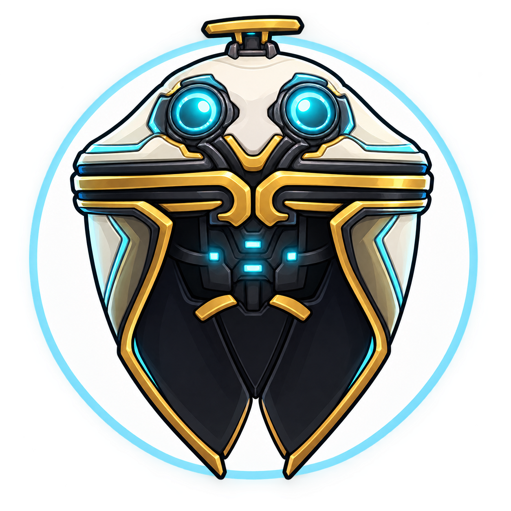

  
  <h1>Cefalón Ordis</h1>

[][repo-link]
[][repo-link]
[][docker-link]

Cefalón Ordis is a self-hosted, customizable dashboard for multiples web browsers.

## Author

### **Borja Gete**

[][borjag90dev-gmail]
[][borjag90dev-github]
[][borjag90dev-linkedin]

[borjag90dev-gmail]: mailto:borjag90dev@gmail.com
[borjag90dev-github]: https://github.com/BorjaG90
[borjag90dev-gitlab]: https://gitlab.com/BorjaG90
[borjag90dev-linkedin]: https://www.linkedin.com/in/borjag90/
[repo-link]: https://github.com/BorjaG90/ordis
[docker-link]: https://www.docker.com/